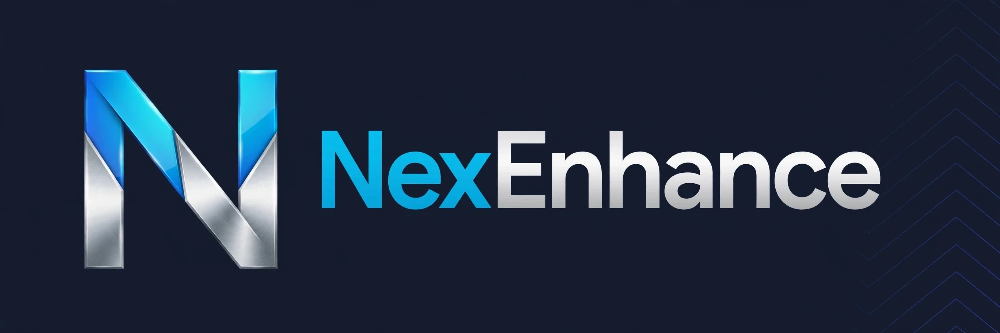

  

     

NexEnhance is a modular add-on for World of Warcraft Retail that improves the default Blizzard UI instead of replacing it. You keep the layout you know, and each feature is a separate module you can turn on or off.

It targets Midnight (patch 12.1.5) and every module is written with the new secret value rules in mind, so nothing breaks in combat.

## What you get

More than 90 modules, grouped in the options panel by what they touch.

- **Chat.** Channel renaming and timestamps, URL and item link copy, an emoji picker (type `:` to start), message filters, and a few quality of life tweaks to the edit box and tabs.
- **Action bars and cursor.** Range coloring, cooldown numbers, a GCD bar, an extra quest button, and an optional cursor ring and trail that follow your mouse.
- **Unit frames and nameplates.** Class and level colors, a player cast bar, target frame layout options, quest indicators, target arrows, and your class resource under the target's nameplate.
- **Inventory.** Already Known tinting at vendors and the Auction House, item levels on gear, a durability tab, junk icons, and a delete-cheapest helper.
- **Automation.** Quick Quest, Auto Vendor, Auto Greed, Smart Fishing, Delves helpers, Auto Role, Auto Keystone, Guild Invite Filter and a pile of smaller ones. Each is off or on by itself.
- **Maps.** Map reveal, a cleaner minimap, world map coordinates, Wowhead links, and `/nex way` for waypoints.
- **Tooltips and data text.** Item, spell and unit IDs, item level on inspect, mount sources, vendor locations, plus clock, gold, friends, guild and stats panels.
- **Announcements.** Level up, quest progress and rare spotted alerts, and a `/pc` pull countdown.
- **Skins and misc.** Character frame stats, chat bubbles, an AFK camera, loot roll bars, queue timer, and a UI scale helper that keeps borders one pixel sharp.

Profiles can be exported and imported from `/nex profile`.

## Install

Pick whichever you use.

- [CurseForge](https://www.curseforge.com/wow/addons/nexenhance)
- [Wago Addons](https://addons.wago.io/addons/nexenhance)
- [GitHub releases](https://github.com/Kkthnx-Wow/NexEnhance/releases), then extract the `NexEnhance` folder into `World of Warcraft\_retail_\Interface\AddOns`

Every release is built by GitHub Actions and uploaded to all three at once, so the versions always match.

## Quick start

1. Log in and run `/nex install` for the recommended setup.
2. Type `/nex` to open the options panel.
3. Toggle modules as you like. Most apply live, a few say "reload to apply."

## Commands

- `/nex` opens the options panel
- `/nex modules` lists every module and whether it's on
- `/nex toggle <module>` flips one module
- `/nex perf` runs the built-in performance profiler (`start`, `stop`, `report`, `bench`, `load`)
- `/nex profile` opens profile import and export
- `/nex editmode` and `/nex keybinds` jump to Blizzard's Edit Mode and key bindings
- `/nex changelog` shows what changed
- `/nex version` prints addon and client info, handy for bug reports
- `/pc [seconds]` starts a pull countdown in group chat

Run `/nex help` for the full list, including the test commands for previews.

## Works alongside

NexEnhance has optional hooks for Details! (a skin) and Pawn (tooltip upgrade icons). Neither is required. Other authors can plug into profiles, events and settings through the plugin API, see the template in `NexEnhance/Examples`.

## Reporting a bug

Open an [issue](https://github.com/Kkthnx-Wow/NexEnhance/issues) with your `/nex version` output and the Lua error text. A BugSack or `/console scriptErrors 1` capture helps a lot.

## Support the work

Free forever. If it saved you time, chip in.

- [Ko-fi](https://ko-fi.com/kkthnx)
- [Buy Me a Coffee](https://buymeacoffee.com/kkthnx)
- [PayPal](https://www.paypal.com/paypalme/kkthnxtv)

## Community

- Glitch Haven Discord: https://discord.gg/FaVGhTYmck
- Website: https://kkthnx.com

## License

Released under the MIT License. See [LICENSE](https://github.com/Kkthnx-Wow/NexEnhance/blob/main/LICENSE) for the terms.
